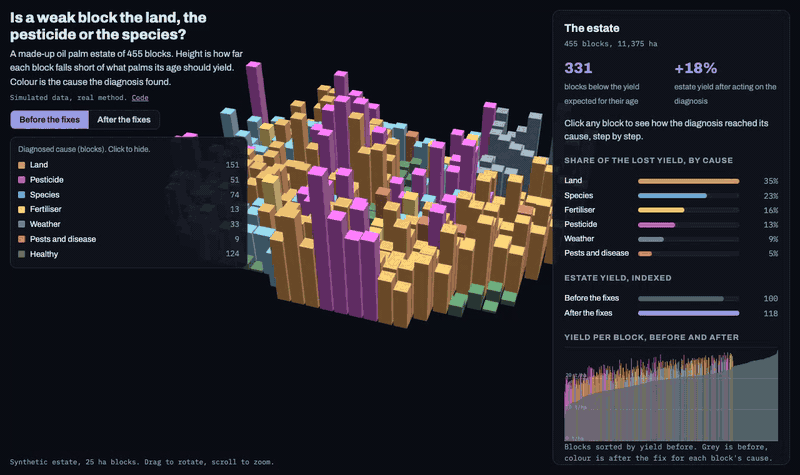

# Root-cause diagnosis for plantation yield

**Live demo: https://dhaneswaramandrasa.github.io/plantation-root-cause/**

[](https://dhaneswaramandrasa.github.io/plantation-root-cause/)

An interactive, simulated version of a project I led at iZeno for an agriculture client: when a plantation block yields poorly, is it the land, the pesticide, the species or something else? We built the diagnosis with the client's agronomists so the field team fixes the right thing. Acting on it lifted yield by 18%. Case study: [Root-cause diagnosis for plantation yield](https://dhaneswara-mandrasa.vercel.app/project-root-cause).

Client data can't be published, so this demo uses **a made-up oil palm estate of 455 blocks of 25 ha**. The method is the same; the numbers are not real results, except that the before and after total is set to the real +18%.

## What it shows

| Part | What happens |
| --- | --- |
| 3D map | One column per block. Height is the yield gap: how far the block falls short of the yield expected for palms its age. Colour is the cause the diagnosis found. Click a cause in the legend to hide it |
| Diagnosis for a block | Click a block to see the checklist it went through, with the evidence at each step, for example: yield 46% of the benchmark, rainfall normal, Ganoderma under 6%, spraying on time, land fails (peat, pH 4.2). Then the cause, the fix, and the block's yield after the fix |
| Loss per cause | For the selected block, the t/ha it would gain if only that cause were at good practice, from the yield model |
| Before and after | Switch to "After the fixes" and the columns shrink. The panel shows estate yield indexed (100 before, 118 after) and every block's yield before and after |

## The method

1. **Join the records per block.** Land (drainage, soil pH, slope), planting material (clone, planting year), spraying (days late, product used), rainfall, pests and disease (Ganoderma incidence), fertiliser (share of the recommended dose), and yield in tonnes of fresh fruit bunches per hectare.
2. **Model what drives yield.** A regression of log yield against the age benchmark on those records (R² 0.94 here). For each block, each coefficient times the block's distance from good practice is that cause's loss in t/ha.
3. **Walk the agronomists' checklist.** In the order they asked for: is the block below its age benchmark; was rainfall normal; are pests under control; was spraying on schedule with the right product; is the land in good shape; is the clone current; was the full fertiliser dose applied. The first check that fails is the cause. If every check passes, the model's largest loss goes to an agronomist to review.
4. **Check the two against each other.** The checklist and the model's largest loss agree on 85% of weak blocks. Where they don't, the block's ranked loss list shows what else to look at.
5. **Act and measure again.** Each cause has a field fix (spray rounds back on schedule, drains cleared and liming, fertiliser matched to the clone and replanting queued, and so on) and a share of the modelled loss it recovers in a season.

| Cause | Blocks | Share of lost yield |
| --- | --- | --- |
| Land | 151 | 35% |
| Species (planting material) | 74 | 23% |
| Fertiliser | 13 | 16% |
| Pesticide | 51 | 13% |
| Weather | 33 | 9% |
| Pests and disease | 9 | 5% |

Fertiliser is a small number of blocks but a large share of the loss, because underdosing shows up as a secondary cause on many blocks whose first cause is something else.

## Data

| Part | Real or synthetic |
| --- | --- |
| Estate, blocks and every record | Synthetic. Hidden effects of drainage, soil, slope, clone, spraying delay, rainfall, Ganoderma and fertiliser drive the yield, with noise the records never see. `scripts/build_data.py` |
| Benchmark yield by palm age | A typical oil palm curve, peaking near 27 t/ha between 9 and 18 years |
| Recovery after the fixes | Recovery rates per cause, with one common scale (0.96) so the estate total lands on the real +18% |

## Run it

```bash
pip install -r requirements.txt     # numpy only
python scripts/build_data.py        # a second or two; writes web/data/estate.json
python -m http.server -d web 8000   # open http://localhost:8000
```

`web/index.html` is a single static page (deck.gl from a CDN, no basemap). `?block=A0813` opens a given block, `?view=after` opens the after view and `?embed` hides the code link. GitHub Actions deploys `web/` to Pages on every push to `main`.

## Layout

```
scripts/build_data.py   synthetic estate, yield model, loss per cause, checklist, fixes, JSON export
web/index.html          the demo
web/data/estate.json    everything the demo reads
```
